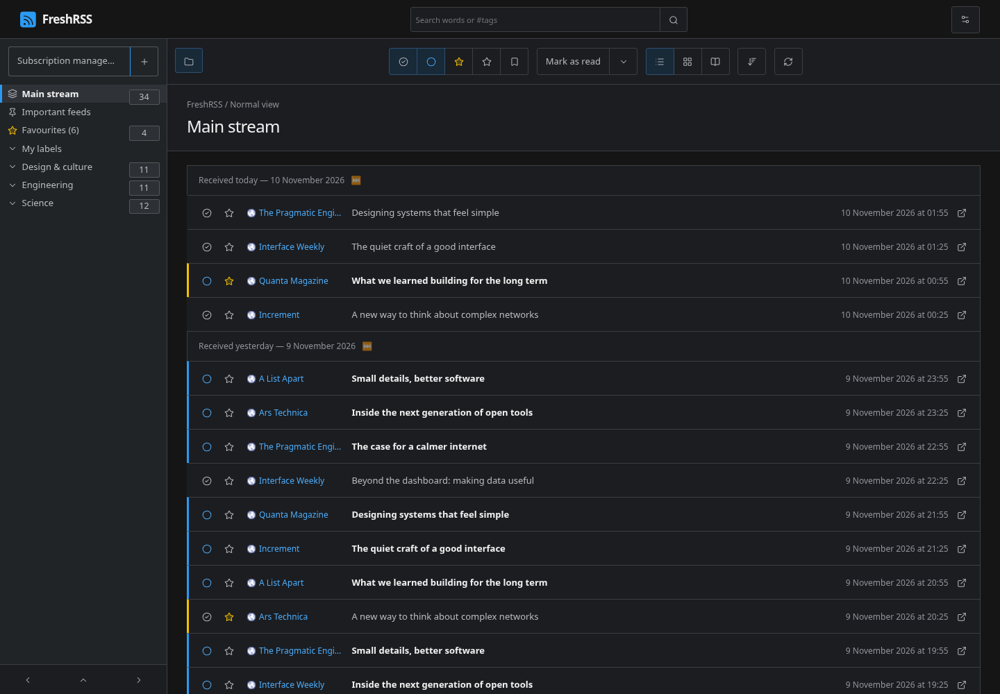
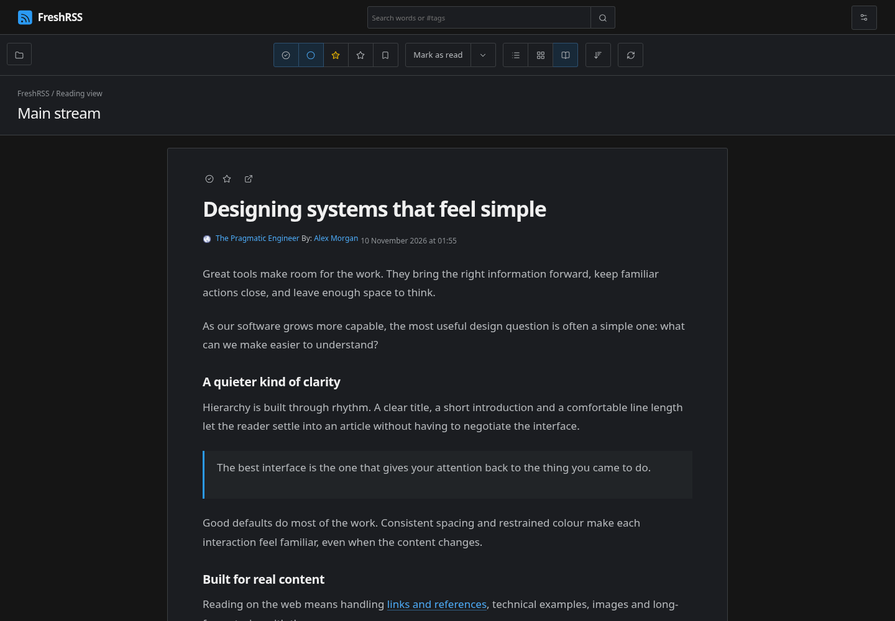

# Corvus for FreshRSS

A dark theme inspired by [Corvus AWPG](https://github.com/corvus-gateway/corvus):
charcoal surfaces, blue accents, thin borders, outline icons and compact article rows.
The article reader uses larger system typography, a comfortable measure, quiet metadata,
and consistent styling for quotations, code and tables.

This is an independent FreshRSS theme, not an official Corvus project.
It follows Corvus's dark appearance regardless of the operating system's colour scheme.

## Preview

Screenshots from a running FreshRSS instance with fictional sample articles:





[Mobile reader](thumbs/mobile.png)

## Install into an existing instance

1. Copy this entire `Corvus` directory into `FreshRSS/p/themes/Corvus`.
   The resulting path must be `p/themes/Corvus/metadata.json`, with no extra nested folder.
2. Make the directory and its files readable by the web server.
3. Reload FreshRSS, open **Configuration → Display**, choose **Corvus**, and submit.

There is no build step, database migration or extension to enable. A regular PHP installation
normally needs no restart. Theme selection is per user. To revert, select the previous theme.
Keep Origine and base-theme installed: Corvus reuses their layout foundations.

For the closest list appearance, choose **Normal view**, collapse articles, set **Website** to
**Icon and name**, disable thumbnails and summaries, and show the publication date.
For long-form reading, try **Reading view** with **Medium** content width.
Other native article-width, metadata, thumbnail and summary settings remain available.

### Docker

Mount the theme into the existing FreshRSS service. For the official FreshRSS image,
add this entry alongside the service's existing volumes:

```yaml
volumes:
  - ./themes/Corvus:/var/www/FreshRSS/p/themes/Corvus:ro
```

Then apply the Compose change with `docker compose up -d`. This recreates the container
when its configuration changes; retain the existing data volumes. Other images may use
a different application path: check the path inside your container first.

If `p/themes` is already persistently mounted, copy Corvus into that directory and refresh
the page. Copying directly into an unmounted container filesystem is temporary and will
be lost when the container is replaced. Keep a copy of the theme outside the application:
FreshRSS does not officially guarantee preservation of personal themes during upgrades.

## User CSS alternative

If you only have access to the FreshRSS web interface:

1. Select **Origine** under **Configuration → Display**.
2. Enable **User CSS** under **Configuration → Extensions**.
3. Paste the contents of `corvus.css` into its configuration editor and save.
   For an RTL interface, use `corvus.rtl.css` instead.
4. Optionally enable **User JS** and paste `corvus.js` to add the workspace heading.

This provides the palette, typography, spacing, lists and reader styling. The custom outline
icons and wordmark require the installed theme; the CSS alternative retains Origine's icons.
Use one installation method at a time so old User CSS does not override newer theme changes.

## Implementation and compatibility

- Tested against FreshRSS `edge`, commit `6af8ebc`, using PHP 8.4 and Chromium.
- No PHP/template changes, frontend framework or remote fonts. Structural administration improvements require the bundled JavaScript.
- CSS reuses Origine and the common FreshRSS base; theme-specific SVG icons replace native icons.
- The script adds page headers, arranges the existing log forms into a data panel, styles native
  pagination, and identifies empty log messages. Existing POST forms and CSRF protection remain
  intact. Article read/favourite/navigation/loading logic stays with FreshRSS.
- Dynamic articles receive the same styles automatically. CSS supports mobile layouts,
  keyboard focus and reduced-motion preferences. RTL CSS is generated with `rtlcss`.
- New log helper labels are currently English; native FreshRSS labels follow the user language.
- Older FreshRSS releases may have different selectors. Validate against your installed version.
- Publishers' inline styling and third-party extensions may need additional overrides.

Validation covered normal, expanded, reading, global and display-settings views; narrow screens
at 320, 390 and 768 pixels; sidebar controls, read/unread toggles, favourites, dynamic article loading and keyboard navigation.
The generated RTL stylesheet was also checked with a Hebrew interface.
CSS and JavaScript passed the repository's Stylelint and ESLint checks.
The full `make test-all` suite could not run because the workspace PHP runtime lacks
Zend OPcache; `make fix-all` also stopped at the unavailable `phpcbf` development tool.

## Administration workspace

Version 1.1 introduces structured administration layouts, uniform form spacing, explicit back/logout
buttons and a logs panel with integrated search and compact pagination. Dates and times use separate
lines; long messages wrap inside the table rather than widening the page.

Empty messages are real records accepted by FreshRSS's log parser. The theme labels them
“No message recorded” and offers a page-local toggle to hide them. Records are never deleted by
this toggle. Pagination still counts the original server records, including hidden empty messages.
If a page contains only empty messages, the toggle starts unchecked so the page remains explainable.
Clearing logs remains the existing explicit FreshRSS action.

The CSS-only installation provides visual overrides; install the full theme or also enable User JS
for the structural administration changes.

## Development

From the FreshRSS repository root:

```sh
npx stylelint p/themes/Corvus/corvus.css
npx eslint p/themes/Corvus/corvus.js
npx rtlcss p/themes/Corvus/corvus.css p/themes/Corvus/corvus.rtl.css
```

Do not edit `corvus.rtl.css` by hand.

## Credits

Design reference: [Corvus AWPG](https://github.com/corvus-gateway/corvus), by Jikwang Moon.
The theme uses its published dark palette as a reference; it does not bundle Corvus's React components.

Outline icons: [Lucide](https://lucide.dev/), with local stroke-colour/width and favourite-fill
adjustments. See [LICENSE-icons.txt](LICENSE-icons.txt) for the ISC and MIT notices.
The FreshRSS wordmark SVG is specific to this theme.
